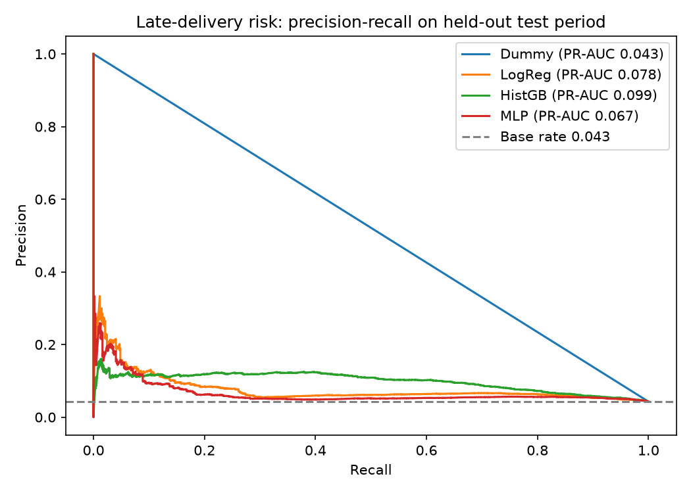

## Delivery-Risk Model (Keras MLP vs baselines)

Task: flag delivered orders likely to arrive later than promised, using only information known at purchase time (no delivery dates, no review score). Time-based split; held-out test set of 14,471 orders, 4.3% late.

| Model | ROC-AUC | PR-AUC | Precision | Recall | F1 |
|---|---|---|---|---|---|
| Dummy baseline | 0.500 | 0.043 | 0.043 | 1.000 | 0.082 |
| Logistic Regression | 0.650 | 0.078 | 0.077 | 0.261 | 0.119 |
| Gradient Boosting | 0.736 | 0.099 | 0.105 | 0.518 | 0.175 |
| Keras MLP | 0.604 | 0.067 | 0.081 | 0.152 | 0.105 |

Gradient boosting performed best. The strongest signals were the promised delivery window, customer state, same-state shipping and freight cost. Predictions are stored in `default.delivery_predictions`.

**Limitations:** historical batch data, weak predictive signal, and monthly late rates vary widely (about 1% to 19%), which order-level features cannot explain. This is a retrospective classifier, not a production early-warning system.



Run: `python ml/train.py`
# E-Commerce Data Warehouse & Analytics — Olist Brazilian Marketplace

**What problem?** E-commerce marketplace teams need to answer sales, delivery-performance,
and customer-satisfaction questions across a real multi-seller, multi-region dataset —
without hand-querying raw exports every time.

**What did I build?** A local, production-style batch data warehouse using **ClickHouse,
Docker, Python, and SQL**, on top of the real [Olist Brazilian E-Commerce dataset](
https://www.kaggle.com/datasets/olistbr/brazilian-ecommerce) (~100k orders, 2016-2018):
raw ingestion → data-quality validation with quarantine → a documented star schema
(with SCD Type 2 customer history) → a 22-query analytics library (window functions,
RFM segmentation, cohort analysis, delivery-delay analysis) → a **Power BI** dashboard.

**How does it work?** See [`docs/architecture.md`](docs/architecture.md).

**What did I discover?** See *Key Insights* below (fill in after your own run).

---

## Architecture

```
Kaggle CSVs ──► Python ingestion ──► raw.* (Bronze) ──► clean.py ──► staging.* (Silver)
                                                                          │
                                                                          ▼
                                                staging.* ──► warehouse.* (Gold, star schema)
                                                                          │
                                                        analytics SQL  +  Power BI
```

## Tech Stack

| Layer | Tool |
|---|---|
| Warehouse | ClickHouse (Docker) |
| SQL client | DBeaver |
| Ingestion / ETL | Python (pandas, clickhouse-connect) |
| Analytics | SQL (window functions, CTEs) |
| BI / Dashboard | Power BI (via ClickHouse ODBC connector) |
| Testing | pytest |

## Why this is more than a basic SQL exercise

- **Real, messy marketplace data** — not synthetic. Olist's `customer_id` is minted
  per order, not per person; this project correctly models the person as
  `customer_unique_id` and handles it as an SCD Type 2 dimension.
- **Data quality quarantine** — every rejected row is logged to `raw.rejected_rows`
  with a reason; every ingestion run writes an audit row to `raw.pipeline_run_log`.
- **Delivery-performance analytics** — Olist has no "returns" data, so instead of
  faking it, this project leans into what the data *actually* offers: on-time vs
  late delivery rates, delay-vs-estimate by region, and the relationship between
  late delivery and review score.
- **22-query analytics library** covering window functions (`RANK`, `LAG`, running
  totals, `ntile`), RFM customer segmentation, and cohort retention.
- **Referential integrity enforcement at load time** — fact rows that can't resolve
  a dimension key are quarantined, not silently dropped or loaded broken.

## Data Model

Star schema — see [`docs/data_dictionary.md`](docs/data_dictionary.md) for full details.

- **Dimensions:** `dim_date`, `dim_customer` (SCD2, keyed on `customer_unique_id`),
  `dim_product`, `dim_category`, `dim_seller`
- **Facts:** `fact_orders` (grain: one order), `fact_order_items` (grain: one order
  line), `fact_payments` (grain: one payment attempt), `fact_reviews` (grain: one review)

## How to Run

```bash
# 1. Start ClickHouse
cp .env.example .env
docker compose up -d

# 2. Install Python deps
pip install -r requirements.txt --break-system-packages

# 3. Get a free Kaggle API token (kaggle.com/settings -> Create New Token),
#    place kaggle.json in ~/.kaggle/ (or C:\Users\<you>\.kaggle\ on Windows),
#    then download the real dataset:
cd ingestion && python download_data.py

# 4. Create schemas — either let docker-entrypoint-initdb.d handle it on first boot,
#    or run each *.sql file in warehouse/ddl/ (raw -> staging -> dimensions -> facts)
#    against ClickHouse via DBeaver.

# 5. Run the pipeline
python load_raw.py --all
cd ../transformations && python clean.py --all
cd ../warehouse && python load_dimensions.py --all && python load_facts.py --all

# 6. Run analytics
#    Open analytics/business_queries.sql in DBeaver against the `warehouse` database

# 7. Connect Power BI — see powerbi/README.md

# 8. Run data quality tests
cd ../tests && pytest -v
```

## Key Insights

*(Fill in after your own run — numbers will match the real dataset, e.g.)*
- On-time delivery rate and how it varies by customer state
- Which product categories have the highest average review score, and which lag
- What share of revenue repeat customers generate vs one-time buyers
- Whether late delivery measurably drags down review scores

## Repository Structure

See [`docs/architecture.md`](docs/architecture.md).
